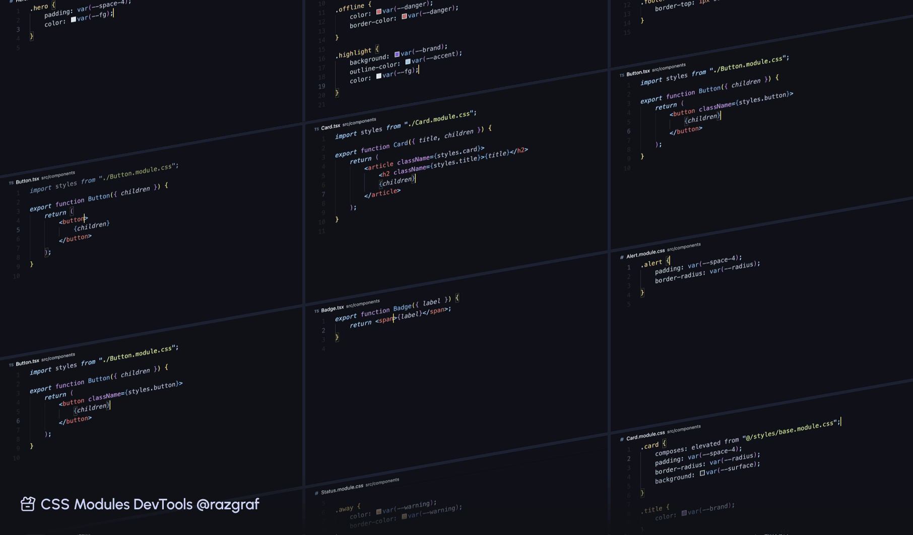
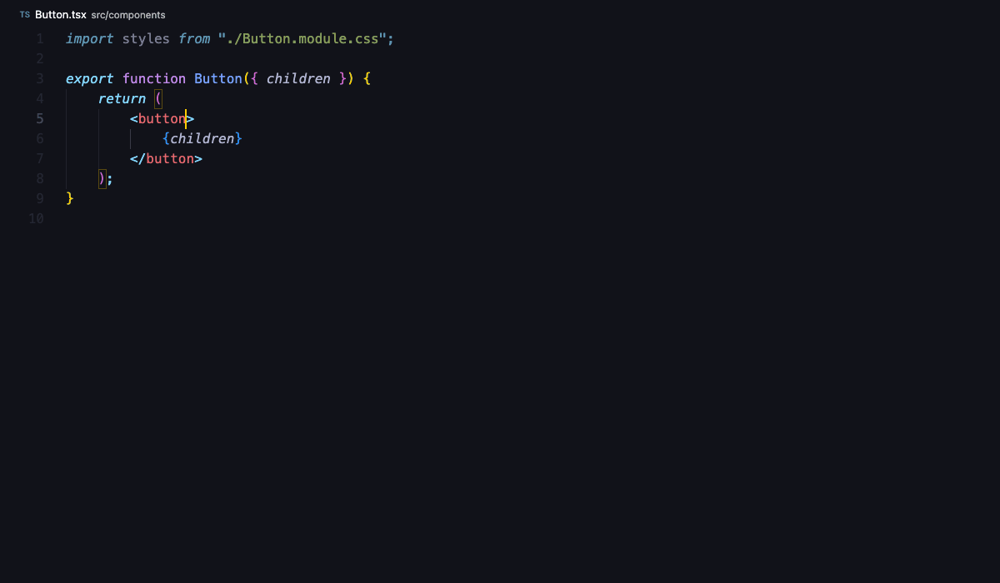
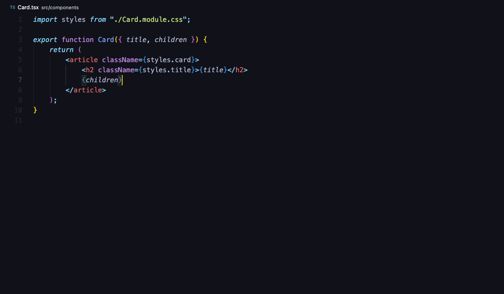
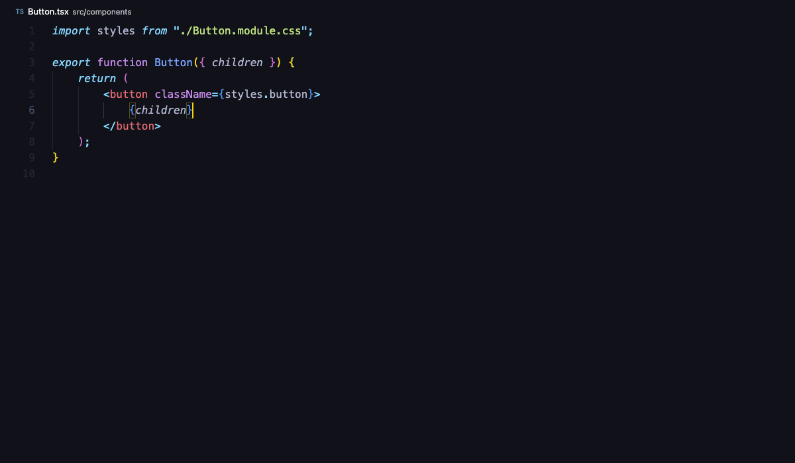
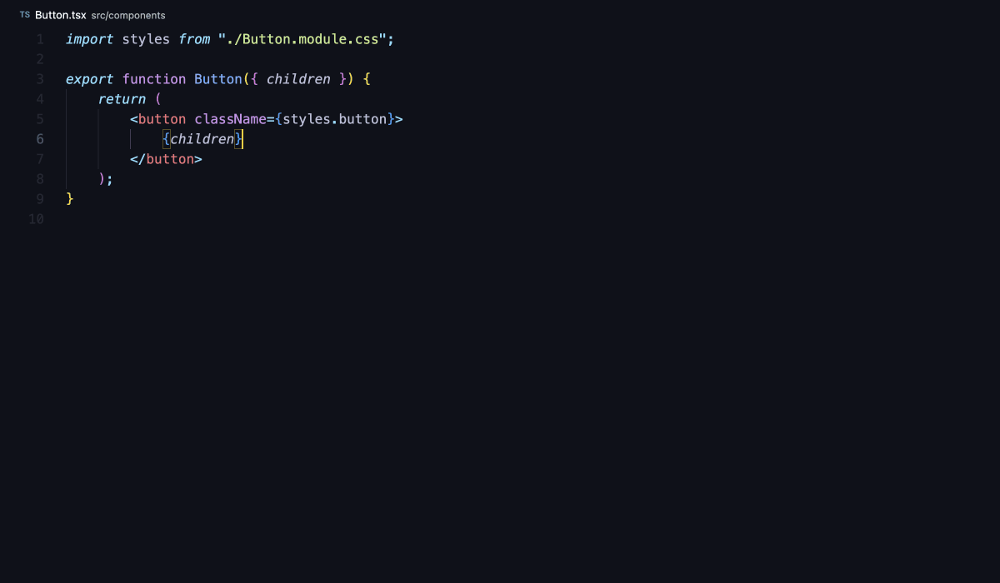
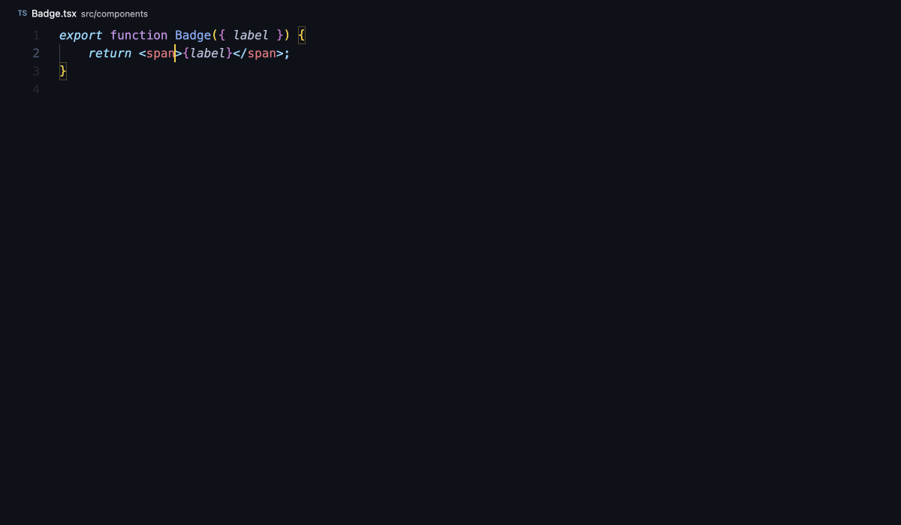
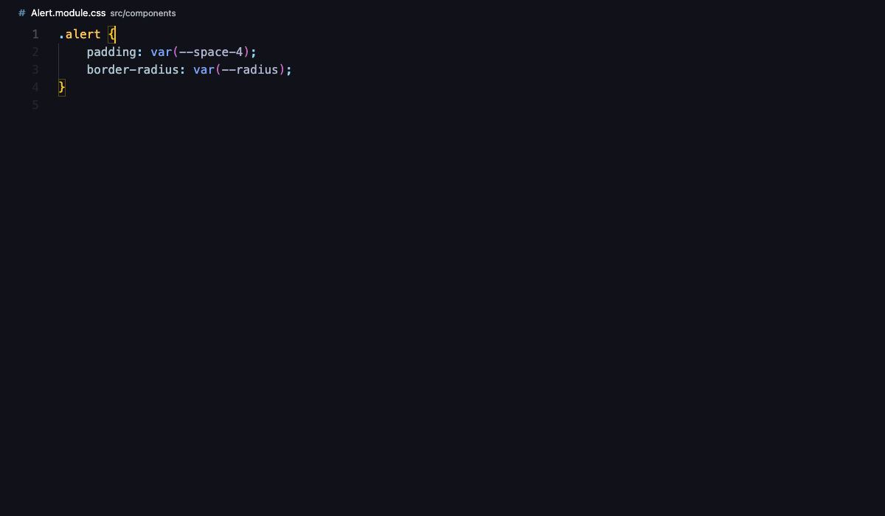
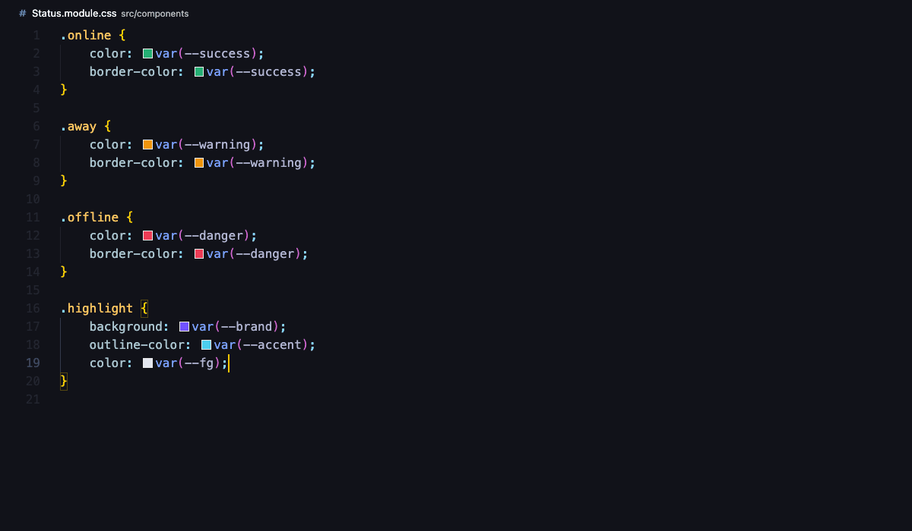
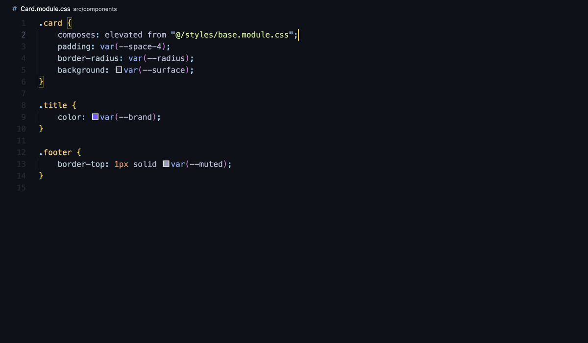

# CSS Modules DevTools

An improved developer experience for CSS in your IDE. Class name completion, go to definition and hover previews, plus `var(--*)` and `composes` completion and color swatches. Works in VS Code and Cursor, with TypeScript 5, 6 and 7.

Inspired by the best parts of [existing extensions](#special-thanks), updated for today's toolchains and combined into one.



## Features

### Class completion

Type `styles.` and pick a class from the imported module. Kebab-case classes insert as `styles['primary-action']`. Works with any import name, `import * as`, named imports, `require()`, and inside template literals.



### Hover preview

Hovering a class shows all its rules in source order, with their `@media` and `@supports` wrappers. Below a `/* ---- composed ---- */` line come the rules of every class it composes, including chained ones, as written in their files. The source files are linked under the preview.



### Go to definition

F12 or Cmd+click on `styles.button` lists every selector that contains `.button`, including `:hover` variants and rules inside `@media`.



### Missing class and missing file checks

`styles.buton` gets an error when the module has no such class. The quick fix offers the closest names ("Did you mean 'button'?") or adds an empty `.buton {}` rule to the module. Imports, `composes … from` and `@import` paths that don't resolve get flagged too. TypeScript can't catch those, because the `declare module '*.module.css'` that Next.js and Vite ship accepts any path.



### Auto-import

Type `styles.` in a file that doesn't import a stylesheet yet. The extension suggests classes from nearby modules, starting with the same-name sibling (`Button.tsx` gets `Button.module.css` first), and adds the import when you accept. The path follows your `typescript.preferences.importModuleSpecifier` setting, so aliases like `@/styles/base.module.css` work. Only the names in `autoImport.identifiers` trigger this, so `expect.` or `Buffer.` never do.



### Acknowledged `composes`

Completion, go to definition and hover for `composes: a b from "./other.module.css"`. That covers local classes, other files, aliased paths, packages and `from global`.

VS Code's built-in CSS checker no longer flags `composes` as an unknown property, so you can drop it from your own `css.customData` file. `:global` and `:local` get completion and hover docs too. VS Code applies this data to every CSS file, so plain `.css` files accept `composes` as well.



### CSS variables

`var(--` completes custom properties from the current file, everything it `@import`s (recursively, cycles included), and the files you list in `globalFiles`. Completion also works in strings in TS/JS files, such as `style={{ color: "var(--brand)" }}`. Hover and go to definition show where a variable is declared and what it resolves to.


### Color swatches

Every `var(--x)` that resolves to a color gets a swatch, following nested variables and fallbacks. Hex, rgb, hsl, hwb, lab, lch, oklab, oklch and named colors all work. The swatch is read-only. To change the color, edit the declaration.



### Global collision checks

CSS Modules don't scope custom properties. If a module redeclares `--brand` at the top level while `globals.css` already declares it, you get a warning that links to the original. `:global(.x)` classes that clash with your global stylesheets or with another module's `:global` get a warning too. Theme overrides inside your global files, such as `[data-theme="dark"]`, are exempt.



## Getting started

### Basics

1. Install **CSS Modules DevTools** from the VS Code Marketplace, or from Open VSX in Cursor.
2. Open a project that imports `*.module.css` files. Nothing else is required for class features.
3. To get variables from your global stylesheet everywhere, point `globalFiles` at it:

   ```jsonc
   // .vscode/settings.json
   {
     "files.associations": { "*.css": "css" }, // Optional, but provides built-in css features (see conflicting extensions below)
     "css.importAliases": { "@/": "/src/" }, // Optional but provide autocomplete for aliased paths
     "cssModulesDevTools.globalFiles": ["src/app/globals.css"],
   }
   ```

### Advanced

1. `globalFiles` patterns are relative to each package root, so in a monorepo every app picks up its own `src/app/globals.css`. Start a pattern with `${workspaceFolder}/` to point at one file for the whole workspace. Package roots stop at the workspace folder, and globs don't follow symlinks.
2. If your bundler converts class names (css-loader's `exportLocalsConvention`), set `classNameConvention` to match. Otherwise `styles.fooBar` is reported as missing.
3. Path aliases come from the nearest `tsconfig.json` or `jsconfig.json` for each file. `extends`, project references, `paths` with or without `baseUrl` (inherited `paths` resolve from the config that declares them, as in TypeScript), and `package.json` `imports` (`#styles/*`) all work. For aliases that only exist in your bundler config, use `pathAlias`.
4. Root-absolute paths such as `@import "/styles/tokens.css"` resolve from the package root, then from the workspace folder, the way Vite does. css-loader's `~` prefix (`@import "~pkg/theme.css"`) resolves from `node_modules` when no alias claims `~`.
5. In Restricted Mode, workspace values of `globalFiles`, `pathAlias` and `nodeModules.enabled` (and of the `cssModules.pathAlias` and `cssVariables.lookupFiles` settings read from other extensions) are ignored. Trust the folder to use them.
6. Every feature can be switched off or tuned in [Settings](#settings). A few extras are off by default: `nodeModules.enabled` follows `@import`s into `node_modules`, and the `localShadowsGlobal` diagnostic flags a local class that reuses a global class name.

#### Disable potentially conflicting extensions

🚧 **Disable these.** They duplicate features of this extension.

- **[vscode-css-modules](https://github.com/clinyong/vscode-css-modules)** duplicates class completion and go to definition. Its `cssModules.pathAlias` keeps working.
- **[vscode-css-variables](https://github.com/vunguyentuan/vscode-css-variables)** duplicates `var()` completion and color swatches. Its `cssVariables.lookupFiles` keeps working when you set it yourself.
- **[typescript-plugin-css-modules](https://github.com/mrmckeb/typescript-plugin-css-modules)** also completes classes in TS/JS, so each class shows up twice. Remove it from your tsconfig `plugins`.

✅ **Keep or disable these.** They work alongside this extension.

- **[css-modules-kit](https://github.com/mizdra/css-modules-kit)**: on TypeScript < 7 this extension hands it the TS/JS side (`tsx.enabled: "auto"`).
- **[PostCSS Language Support](https://github.com/csstools/postcss-language)** (`csstools.postcss`) opens `.css` files in its own `postcss` language mode, and this extension works in either mode. VS Code's built-in CSS features (its own completions, lint and color picker) only run in `css` mode, so map the files back if you miss them:

  ```jsonc
  // .vscode/settings.json
  "files.associations": { "*.css": "css" }
  ```

  You can check a file's language mode in the status bar.

- **Other color extensions** that draw swatches for `var()` show a second swatch. Set `variables.colors` to `false` to keep only theirs.

## Settings

All settings live under the `cssModulesDevTools` object/prefix.

| Setting                  | Default                             | What it does                                                                                                                                                                                                                                            |
| ------------------------ | ----------------------------------- | ------------------------------------------------------------------------------------------------------------------------------------------------------------------------------------------------------------------------------------------------------- |
| `globalFiles`            | `[]`                                | Share your global stylesheet's variables with every module. `["src/app/globals.css"]` gives `var(--brand)` completion in `Button.module.css` without an `@import`. Their `@import`s are followed.                                                       |
| `pathAlias`              | `{}`                                | Resolve aliases that only exist in your bundler config. `{ "@styles": "${workspaceFolder}/src/styles" }` makes `@import "@styles/tokens.css"` resolve. Checked before tsconfig, supports `${workspaceFolder}` and `${packageRoot}`.                     |
| `classNameConvention`    | `"asIs"`                            | Match css-loader's `exportLocalsConvention`. With `camelCase`, `.primary-action` is offered as `styles.primaryAction` and `styles['primary-action']`. `camelCaseOnly` keeps just `styles.primaryAction`. `dashes` and `dashesOnly` convert dashes only. |
| `diagnostics`            | see below                           | Severity per check: `off`, `hint`, `info`, `warning` or `error`. For example, `"missingClass": "warning"` while migrating a codebase.                                                                                                                   |
| `autoImport.identifiers` | `["styles", "classes", "css", "s"]` | Names that trigger auto-import when typed without an import. Add yours, such as `"cls"` for `cls.`, or set `[]` to turn auto-import off.                                                                                                                |
| `variables.colors`       | `true`                              | Color swatches next to `var(--brand)` when it resolves to a color. Turn off if another extension already draws them.                                                                                                                                    |
| `hover.maxLines`         | `30`                                | Longest hover preview before it's cut off. Raise it for classes that compose a lot.                                                                                                                                                                     |
| `tsx.enabled`            | `"auto"`                            | Class features in TS/JS files: `on`, `off` or `auto`. `auto` hands them to css-modules-kit when its TS plugin is active on TypeScript < 7.                                                                                                              |
| `autoImport.enabled`     | `true`                              | Suggest nearby modules when you type `styles.` in a file that doesn't import one yet.                                                                                                                                                                   |
| `variables.tsxStrings`   | `true`                              | `var(--*)` completion inside TS/JS strings, as in `style={{ color: "var(--brand)" }}`.                                                                                                                                                                  |
| `nodeModules.enabled`    | `false`                             | Follow `@import`s and `globalFiles` globs into `node_modules`, e.g. when `globals.css` has `@import "open-props/style.css"`. A single `composes … from "pkg/x.module.css"` works without it.                                                            |
| `varShadow.maxDepth`     | `0`                                 | How deeply nested a redeclared global variable can be and still get flagged. `0` catches `.card { --brand: red }`, also inside `@media`. `1` adds `.card { &:hover { --brand: red } }`. `-1` means any depth.                                           |
| `completion.enabled`     | `true`                              | Class completion in TS/JS and in `composes`.                                                                                                                                                                                                            |
| `definition.enabled`     | `true`                              | Go to definition for classes, `composes` and `var()`.                                                                                                                                                                                                   |
| `hover.enabled`          | `true`                              | Hover previews for classes and variables.                                                                                                                                                                                                               |
| `variables.enabled`      | `true`                              | Completion, definition and hover for `var(--*)`.                                                                                                                                                                                                        |

```jsonc
"cssModulesDevTools.diagnostics": {
  "missingClass": "error",
  "missingFile": "error",
  "varShadowsGlobal": "warning",
  "globalClassCollision": "warning",
  "localShadowsGlobal": "off" // a local .btn when globals.css also has .btn
}
```

### Settings read from other extensions

If you're switching from another extension, a few of its settings carry over while ours are unset.

| Their setting                                                                                                                                         | Used as                |
| ----------------------------------------------------------------------------------------------------------------------------------------------------- | ---------------------- |
| `cssModules.pathAlias` ([clinyong/vscode-css-modules](https://github.com/clinyong/vscode-css-modules))                                                | `pathAlias`            |
| `cssVariables.lookupFiles` ([vunguyentuan/vscode-css-variables](https://github.com/vunguyentuan/vscode-css-variables)), only when you set it yourself | `globalFiles`          |
| `typescript.preferences.importModuleSpecifier` (built in)                                                                                             | auto-import path style |

Running this extension next to either of those two shows duplicate suggestions, so you get a one-time prompt to disable them. See [Disable potentially conflicting extensions](#disable-potentially-conflicting-extensions).

## Works well with

- **[Biome](https://biomejs.dev/)'s `noUndeclaredCustomProperties`** reports `var(--x)` with no declaration. This extension deliberately doesn't, so the two never disagree. Biome follows the import graph and has no option for global files, so a variable that only reaches a module through your layout's `globals.css` may be flagged. Turn the rule off for those files with `overrides` if that happens.
- **[css-modules-kit](https://github.com/mizdra/css-modules-kit)** on TypeScript 5 or 6 gives TypeScript real types for your modules, which means rename, find references and `tsc` errors for missing classes. When its plugin is active, this extension leaves the TS/JS side to it and keeps hover, variables, colors and the CSS-side checks. On TypeScript 7 css-modules-kit's plugin can't load, and this extension handles both sides.

Note: This extension runs as its own language server and never loads TypeScript, so it behaves the same whichever TS version your workspace uses. It also means nothing runs inside `tsserver`, so it can't slow down your TS completions.

## Known limitations

- **Duplicate entry in go to definition.** Next.js and Vite ship a `declare module '*.module.css'`, and TypeScript returns it next to the real CSS rule. Extensions can't hide each other's results, so F12 shows a short list.
- **No rename or find references from TS/JS files.** TypeScript owns those requests. TS 7 content mappers will make this possible, and it's on the roadmap.
- **Plain CSS only.** No SCSS, Less, Stylus, Vue, Svelte or Astro yet. Open an issue if you need one.
- **The auto-import check is textual.** It skips `styles` when the name is declared anywhere in the file, not per scope.
- **TypeScript can grab an unimported `styles.`** While you type `styles`, TypeScript suggests the DOM global `StyleSheet`, and the `.` accepts that suggestion. Press Escape before the dot, or set `"editor.acceptSuggestionOnCommitCharacter": false`.
- **Windows is untested.** Resolved paths are normalized to native separators, but CI only runs on Linux. Please report path issues.
- **Root-absolute paths follow Vite.** `/x.css` is checked as a real file path first, then under the package root and the workspace folder. A bundler that serves `/` from another folder, such as `public/`, isn't followed.
- **`:global` collisions** are checked against your global files and against modules already opened in this session. There's no workspace scan, so a clash with a module you haven't opened stays hidden until you open it.

## How it compares

| Feature                         | This extension | [css-modules-kit](https://github.com/mizdra/css-modules-kit) | [typescript-plugin-css-modules](https://github.com/mrmckeb/typescript-plugin-css-modules) | [vscode-css-modules](https://github.com/clinyong/vscode-css-modules) | [vscode-css-variables](https://github.com/vunguyentuan/vscode-css-variables) |
| ------------------------------- | -------------- | ------------------------------------------------------------ | ----------------------------------------------------------------------------------------- | -------------------------------------------------------------------- | ---------------------------------------------------------------------------- |
| Works on TypeScript 7           | Yes            | Not yet                                                      | No                                                                                        | Yes                                                                  | Yes                                                                          |
| Class completion                | Yes            | Yes                                                          | Yes                                                                                       | Yes                                                                  | No                                                                           |
| Go to definition                | Yes            | Yes                                                          | Experimental                                                                              | Yes                                                                  | No                                                                           |
| Hover with rules and `composes` | Yes            | Definition peek                                              | Types only                                                                                | No                                                                   | No                                                                           |
| Missing class errors            | Yes            | Yes, through tsc                                             | Yes, in the editor                                                                        | No                                                                   | No                                                                           |
| Rename and find references      | No             | Yes                                                          | No                                                                                        | No                                                                   | No                                                                           |
| Native CSS nesting (`&`)        | Yes            |                                                              |                                                                                           | No                                                                   | n/a                                                                          |
| tsconfig aliases in monorepos   | Yes            | Yes                                                          | Partial                                                                                   | Needs `baseUrl`                                                      | n/a                                                                          |
| camelCase conventions           | Yes            | No                                                           | Yes                                                                                       | Yes                                                                  | n/a                                                                          |
| `var()` completion              | Yes, scoped    | No                                                           | No                                                                                        | No                                                                   | Yes, workspace-wide                                                          |
| Color swatches                  | Yes            | No                                                           | No                                                                                        | No                                                                   | Yes                                                                          |
| SCSS and Less                   | No             | No                                                           | Yes                                                                                       | Yes                                                                  | Yes                                                                          |

## Special thanks

Most of these features already existed, spread across a handful of popular extensions. This one brings them together under a single roof, and it owes a lot to the people who built them first.

- Class completion and go to definition follow [clinyong/vscode-css-modules](https://github.com/clinyong/vscode-css-modules), along with the `pathAlias` setting and `require()` support.
- Diagnostics through type information, the "add missing rule" quick fix and sibling-first auto-import come from [css-modules-kit](https://github.com/mizdra/css-modules-kit).
- Hover previews of rule contents, missing module diagnostics and nearest-module auto-import were done first by [React CSS modules](https://github.com/Viijay-Kr/react-ts-css), which is no longer maintained.
- `var()` completion, `lookupFiles` and color swatches come from [vscode-css-variables](https://github.com/vunguyentuan/vscode-css-variables).
- Typed class names with editor errors come from [typescript-plugin-css-modules](https://github.com/mrmckeb/typescript-plugin-css-modules).
- Inlining `composes` declarations into the hover, `composes` completion, the global namespace checks, per-package `globalFiles` and working the same on every TypeScript version are new here.

The extension icon is built with [Lucide](https://lucide.dev) icons, licensed under ISC.

The extension was built using AI agents.

## License

MIT
